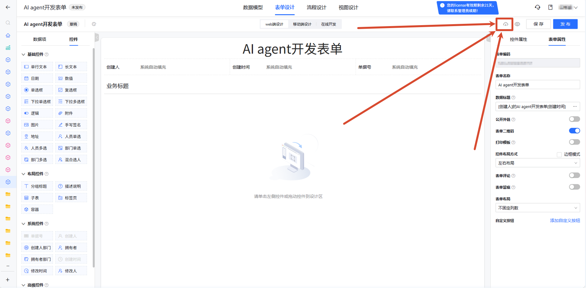
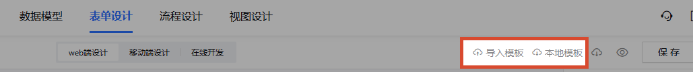
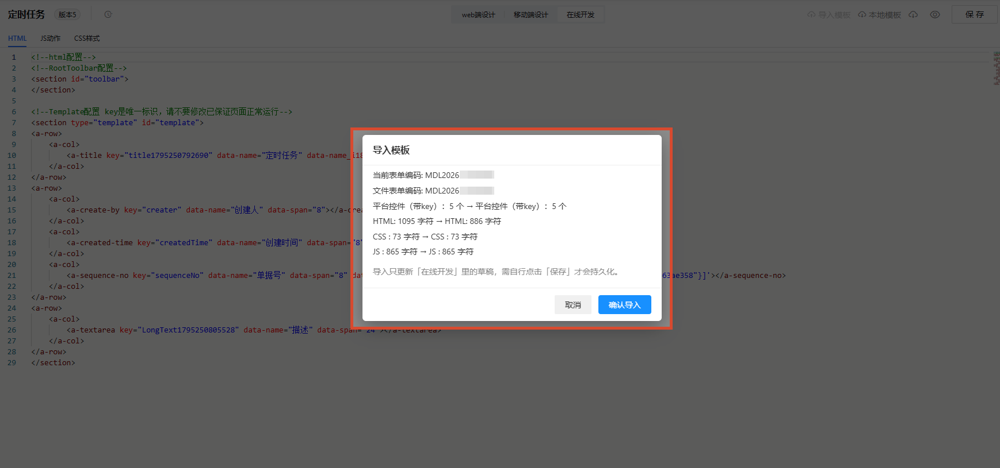

# 云枢表单脚手架

用于奥哲云枢（Authine CloudPivot）低代码表单自定义开发的 TypeScript 类型辅助工具，支持 VSCode 智能提示和 AI Agent 自动编程。

## 功能特性

- ✅ **VSCode 智能提示** - 控件属性、方法自动补全
- ✅ **AI Agent 编程支持** - OpenCode、Trae 等 AI 工具自动生成代码
- ✅ **类型安全** - TypeScript 类型检查，减少运行时错误
- ✅ **代码模式参考** - 内置常用代码模式，快速上手
- ✅ **浏览器脚本助手** - 云枢表单设计页一键「本地模板」导出 / 「导入模板」写回（含自定义 HTML/CSS/JS）

---

## 环境准备

### 1. 安装 Node.js

**Windows 系统**：

1. 访问 [Node.js 官网](https://nodejs.org/)
2. 下载 LTS 版本（推荐 v18 或更高版本）
3. 运行安装程序，一路下一步
4. 打开命令行验证安装：

```bash
node -v    # 应显示 v18.x.x 或更高
npm -v     # 应显示 9.x.x 或更高
```

**macOS 系统**：

```bash
# 使用 Homebrew 安装
brew install node

# 或下载安装包
# https://nodejs.org/
```

**Linux 系统**：

```bash
# Ubuntu/Debian
curl -fsSL https://deb.nodesource.com/setup_18.x | sudo -E bash -
sudo apt-get install -y nodejs

# CentOS/RHEL
curl -fsSL https://rpm.nodesource.com/setup_18.x | sudo bash -
sudo yum install -y nodejs
```

### 2. 安装编辑器

- **VSCode**（推荐）：[下载地址](https://code.visualstudio.com/)
- 或其他支持 TypeScript 的编辑器

### 3. 安装篡改猴（Tampermonkey）+ 本地脚本（可选，推荐）

表单设计页上的「本地模板」「导入模板」两个按钮由 `scripts/cloudpivot-template-export.user.js` 提供，需要一个用户脚本管理器来运行它。共三步：**装篡改猴插件 → 开启「允许用户脚本」→ 拖入本地脚本**。以 Edge 为例，完整图文教程见 [Edge浏览器安装篡改猴插件和添加脚本](https://blog.csdn.net/u010161190/article/details/171362696)。

**安装篡改猴插件**：

1. Edge 右上角菜单 → 「获取 Microsoft Edge 扩展」，打开扩展商店；
2. 搜索栏输入「篡改猴」，点击弹窗中的扩展图标；
3. 在扩展详情页点击「安装」；
4. 在弹出的提示里点击「添加扩展」；
5. 打开扩展栏（拼图图标），把篡改猴固定显示到工具栏，方便以后管理脚本。

**开启「允许用户脚本」**（Edge / Chrome 新版篡改猴是 MV3 扩展，不开这个开关脚本不会注入页面）：

1. 进入管理扩展页（Edge：`edge://extensions/`，地址栏直接输入即可）；
2. 找到篡改猴，点击「详细信息」；
3. 勾选 **「允许用户脚本」**（需要无痕/InPrivate 里也用脚本的，同时勾选「在 InPrivate 中允许」）。

> 这一步是 Edge 装完篡改猴后「按钮不出现」的最常见原因，勾完刷新云枢页面即可。

**添加本地脚本**：

1. 点击篡改猴图标 → 「管理面板」；
2. 把 `scripts/cloudpivot-template-export.user.js` 从资源管理器直接拖进管理面板页面；
3. 在「安装 云枢表单模板导出 / 导入（本地 template.html）」页面点击「安装」；
4. 回到管理面板，脚本列表里出现它、且开关为启用状态，即安装完成。

> Chrome / Edge / Firefox 的入口一致：扩展商店装篡改猴 → 管理面板拖入 `.user.js` → 点「安装」。脚本装好后无需再动，浏览器里打开云枢表单设计页即自动生效。
>
> 「允许用户脚本」是 Edge / Chrome 的 MV3 要求，Firefox 的篡改猴没有这个开关，装完插件直接拖脚本即可。

---

## 快速开始

### 第一步：获取脚手架

```bash
# 克隆或下载项目
git clone https://github.com/sd133cn/cloudpivot-js-help.git
cd cloudpivot-js-help

# 安装依赖
npm install
```

### 第二步：导出云枢模板

1. 在云枢平台设计表单

2. 在表单设计页点「**本地模板**」（篡改猴脚本提供的按钮），得到 `template-<表单编码>-YYMMDD_HHmmss.html`，复制为项目根目录的 `template.html`。按钮位置与脚本安装见 [浏览器脚本：云枢导入 / 导出](#浏览器脚本云枢导入--导出)

   > 云枢自带的「导出」按钮只导出控件 HTML，表单里已写的 CSS / JS / 自定义 HTML 会被丢掉。用平台自带导出时，请核对产物里 `<style>` 与 `<script id="customScript">` 是否为真实内容。
   >
   > 

### 第三步：生成类型定义

```bash
npm run extract
```

这将生成：

- `src/custom.html` - HTML 片段
- `src/custom.css` - CSS 样式
- `src/custom.js` - JavaScript 代码（checkJs 提供类型补全）
- `src/custom-types.d.ts` - 类型定义

---

## 浏览器脚本：云枢导入 / 导出

云枢自带的「导出」按钮只产出控件 HTML：`<style>` 与 `<script id="customScript">` 是硬编码的默认值，自定义 HTML 区域也没有插槽——表单里写好的 CSS、JS、自定义 HTML 会全部丢掉。`scripts/cloudpivot-template-export.user.js` 补上这一段，在表单设计页工具条上加「本地模板」和「导入模板」两个按钮。

### 按钮位置

脚本只在表单设计页运行，路由形如：

```
/admin/#/apps/model/{应用编码}/{模型编码}/form-design/{表单编码}
```

装好脚本后打开任意表单的设计页，工具条右侧的图标组里，云枢自带「导出」图标的左边会多出两个：

```
…  ⬆ 导入模板   ⬇ 本地模板   ⬇ 导出（云枢自带） …
```



红框里就是脚本新增的两个按钮，右边依次是云枢自带的「导出」「预览」「保存」。鼠标悬停在按钮上有各自的作用说明。

### ⬇ 本地模板（导出到本地）

点一下即下载 `template-<表单编码>-YYMMDD_HHmmss.html`，控件部分与云枢自带导出一致，另外补齐自定义内容：

- `<style>` 写入表单当前的 CSS；
- `<script id="customScript">` 写入表单当前的 JS；
- `<!--html配置-->` 之后追加自定义 HTML 区域（自定义 HTML 控件、容器、子表列、按钮组等）；
- `<body>` 后写入一行 `<!--cloudpivot-form-code:表单编码-->`，供 `npm run build-import` 给导入产物命名。

拿到文件后：

```bash
# 覆盖根目录模板（会覆盖 src/ 全部文件，已有代码先备份）
copy template-MDL202611214110-261125_120000.html template.html   # Windows
cp  template-MDL202611214110-261125_120000.html template.html   # macOS / Linux
npm run extract

# 或不覆盖 template.html，直接解析该文件
npm run extract -- template-MDL202611214110-261125_120000.html
```

### ⬆ 导入模板（从本地写回云枢）

先把三份文件合并成导入产物：

```bash
npm run build-import
# 产出 dist/template-<表单编码>-import.html
```

> 表单编码取自「本地模板」写进文件的标记；旧导出文件没有这行标记时，用 `npm run build-import -- --code=MDL202611214110` 手动指定，否则文件名里是 `unknown`，导入时确认框也会提示无法核对编码。

点「导入模板」选中该文件，脚本会：

1. 自动切到「在线开发」视图，并等平台把编辑器内容生成稳定（否则导入内容会被覆盖）；
2. 用平台自己的解析器拆出 HTML / CSS / JS，更新控件树与 `elements`；
3. 弹确认框，显示当前表单编码、文件表单编码，以及控件数量与 HTML/CSS/JS 字符数的导入前后对比；
4. **文件编码与当前页面编码对不上（或文件没有编码标记）时，确认框顶部显示红色警告**，确认按钮默认置灰，避免把 A 表单的产物写进 B 表单；
5. 取消或解析失败会回滚编辑器内容。



确认框里上面两行核对表单编码（当前页面 / 所选文件），中间是控件数量与 HTML / CSS / JS 字符数的导入前后对比，底部提醒导入只更新草稿。编码一致时「确认导入」可直接点击；不一致时顶部出现红色警告、按钮置灰。

> **导入只更新「在线开发」里的草稿**，核对无误后仍需手动点击「保存」，发布同样由人点击。
>
> 导入产物的边界与云枢解析器一致，因此有已知损失：表单级布局 / 边框模式、权限、数据规则、模型字段完整定义、`history-opt-*` 等非 `data-*` 元数据无法由 HTML 表达；自定义 HTML 控件的 key 会被平台重新生成为 `Html1`、`Html2`……**导入产物只用于同一表单，不要跨模型套用。**

---

## 使用场景

### 场景一：VSCode 智能提示

#### 开启类型检查

```bash
npm run dev
```

VSCode 会自动识别类型定义，实现：

**控件自动补全**：

```typescript
// 输入 this. 后自动提示所有可用控件
this.ShortText1775207152511.  // 自动提示 value, display, required 等
```

**方法提示**：

```typescript
// 子表方法自动补全
this.sheetField.appendRow(  // 自动提示参数类型
this.sheetField.getCell(    // 自动提示参数类型
```

**生命周期模板**：

在 `src/custom.js` 中已预置生命周期模板，直接编写业务逻辑即可：

```typescript
form.on('onLoad', function(data, dataPermission) {
  // 输入 data. 自动提示所有控件 key
  // 输入 this. 自动提示所有控件和方法
});

form.on('onRendered', function(data) {
  // 控件访问示例
  this.textField.value = 'hello';
});
```

#### 类型检查效果

| 功能          | 效果                                    |
| ----------- | ------------------------------------- |
| 控件 key 自动补全 | ✅ 输入 `this.` 或 `data.` 后提示            |
| 控件属性提示      | ✅ 显示 `value`, `display`, `required` 等 |
| 方法参数提示      | ✅ 显示参数类型和说明                           |
| 类型错误提示      | ✅ 赋值类型错误会红色波浪线                        |

#### 类型覆盖范围

类型定义覆盖的是**运行时控件 API**（`value`、`display`、`required`、`edit`、各 `validate*` 校验方法、子表行列表方法等，见 `types/controls.d.ts`，与官方《3.表单控件API》的共有属性一一对应）。

表单设计器里的「显示条件 / 必填条件 / 只读条件 / 计算规则 / 数据联动」属于**控件选项**（`displayFormula`、`requiredFormula`、`computeFormula` 等，官方《4.表单控件选项API》），随 `template.html` 导出为 `data-display-formula` 等属性透传到 `src/custom.html`，由平台在运行时解释生效，**不需要在 JS 二开中实现**（官方明确不建议运行时修改选项属性）。要在代码里做等价控制，用运行时属性：

| 设计器配置 | 代码等价写法 |
| ---- | ---- |
| 显示条件 | `this.控件Key.display = true/false` |
| 必填条件 | `this.控件Key.required = true/false` |
| 只读条件 | `this.控件Key.edit = false` |
| 数据联动 / 计算规则 | `this.控件Key.valueChange.subscribe(...)` 中赋值 |

---

### 场景二：AI Agent 自动编程

#### 支持的 AI 工具

- **OpenCode** - 推荐
- **DeepSeek Harness** - 推荐
- **Qoder**
- **Zcode**
- 其他支持项目文档的 AI 编程工具

#### 使用方法

**方式一：直接对话**（推荐）

OpenCode、DeepSeek Harness 等工具会自动把项目根目录的 `AGENTS.md` 载入上下文，并按其中的指引加载 `cloudpivot-form-dev` skill，**对话时无需点名文件**。AI 会自动获得：

- 项目结构和关键约束
- 代码模式参考、控件使用方法、生命周期事件说明
- 官方 API 原文（`docs/form-api/`）的查询路由

**示例对话**：

```
用户：帮我在custom.js实现一个功能，当金额超过 10000 时，自动显示审批人字段

AI：（AGENTS.md 与 skill 已在上下文中，按项目约束生成代码）
form.on('onRendered', function(data) {
    var form = this; // function 回调内 this 不指向表单，需先捕获
    form.amount.valueChange.subscribe(function(change) {
        if (change.value > 10000) {
            form.approver.display = true;
            form.approver.required = true;
        } else {
            form.approver.display = false;
            form.approver.required = false;
        }
    });
});
```

#### AI Agent 的优势

| 传统方式        | AI Agent 方式 |
| ----------- | ----------- |
| 手动查阅 API 文档 | 自动理解项目约束    |
| 容易写错控件 key  | 自动补全正确的 key |
| 不熟悉生命周期     | 自动选择正确的事件   |
| 代码风格不一致     | 遵循项目已有模式    |

---

## 开发流程

### 完整工作流

```
┌─────────────────────────────────────────────────────────────┐
│  首次使用                                                    │
├─────────────────────────────────────────────────────────────┤
│  1. npm install                 # 安装依赖                   │
│  2. 点「本地模板」导出          # 覆盖 template.html         │
│  3. npm run extract             # 生成 src/ 文件             │
│  4. 编辑 src/custom.js          # 编写业务代码               │
│  5. npm run dev                 # 开启类型检查               │
│  6. npm run build-import        # 合并产物导入云枢          │
└─────────────────────────────────────────────────────────────┘

┌─────────────────────────────────────────────────────────────┐
│  模板更新后（会覆盖所有文件！）                                │
├─────────────────────────────────────────────────────────────┤
│  1. 点「本地模板」导出          # 覆盖 template.html         │
│  2. npm run extract             # 重新生成（覆盖 custom.js） │
└─────────────────────────────────────────────────────────────┘

┌─────────────────────────────────────────────────────────────┐
│  已有代码，只想更新类型                                       │
├─────────────────────────────────────────────────────────────┤
│  1. 编辑 src/custom.html        # 手动添加新控件             │
│  2. npm run refresh-types       # 更新类型，保留用户代码     │
└─────────────────────────────────────────────────────────────┘

┌─────────────────────────────────────────────────────────────┐
│  改完要整体回传云枢                                          │
├─────────────────────────────────────────────────────────────┤
│  1. npm run build-import        # 生成 dist/ 导入文件        │
│  2. 点「导入模板」导入该文件     # 只更新草稿                │
│  3. 核对后手动点击「保存」       # 发布仍需自行点击          │
└─────────────────────────────────────────────────────────────┘
```

### 脚本命令

| 命令                      | 用途                              | 覆盖文件             |
| ----------------------- | ------------------------------- | ---------------- |
| `npm run extract`       | 从 template.html 完整生成（可传文件路径）  | 全部覆盖             |
| `npm run refresh-types` | 仅更新类型定义                        | 仅类型文件，保留用户代码     |
| `npm run build-import`  | 合并 src 三文件为导入用单文件              | 仅写 dist/，不动 src/ |
| `npm run validate-api`  | 离线校验 OpenWebAPI 端点与请求体          | 不修改文件            |
| `npm run dev`           | 类型检查监听                          | 不修改文件            |

---

## 文件说明

```
cloudpivot-js-help/
├── template.html           # 云枢导出的原始模板（只读）
├── src/
│   ├── custom.html         # HTML 片段 → 复制到云枢 HTML 窗口
│   ├── custom.css          # CSS 样式 → 复制到云枢 CSS 窗口
│   ├── custom.js           # JavaScript 代码 → 直接复制到 JS 窗口
│   └── custom-types.d.ts   # 类型定义（自动生成，勿编辑）
├── types/                  # 静态类型定义
│   ├── controls.d.ts       # 控件类型
│   ├── form-instance.d.ts  # 表单实例类型
│   └── lifecycle.d.ts      # 生命周期类型
├── .agents/skills/
│   └── cloudpivot-form-dev/ # AI 二开 skill（代码模式、控件清单、API 路由）
├── docs/                   # 外部参考原文（云枢官方文档，只读）
│   ├── form-api/           # 表单开发 API 文档
│   ├── openapi/            # 第三方客户端 OpenAPI 原文
│   └── openwebapi/         # OpenWebAPI 平台接口原文
├── scripts/
│   ├── extract.mjs                     # 完整生成脚本
│   ├── refresh-types.mjs               # 类型刷新脚本
│   ├── build-import.mjs                # 合并导入用单文件
│   ├── validate-webapi.mjs             # OpenWebAPI 请求校验器
│   └── cloudpivot-template-export.user.js  # 篡改猴脚本：云枢页的导入/导出按钮
├── assets/                 # README 截图（云枢界面示意）
├── dist/                   # build-import 产出（导入文件，不入库）
└── AGENTS.md               # AI Agent 指引文档（被 AI 工具自动载入）
```

---

## 添加新控件

### 方式一：完整更新

1. 在云枢平台设计表单，添加新控件
2. 点「本地模板」导出，覆盖 `template.html`
3. 运行 `npm run extract`

> ⚠️ 注意：会覆盖所有 src/ 文件，已有代码会丢失！

### 方式二：仅更新类型（推荐）

1. 手动编辑 `src/custom.html`，按格式添加控件
2. 运行 `npm run refresh-types`

**控件格式参考**：

```html
<!-- 短文本 -->
<a-text key="ShortTextXXXXXXXXXXXX" data-name="控件名称" data-span="24"></a-text>

<!-- 数值 -->
<a-number key="NumberXXXXXXXXXXXX" data-name="控件名称" data-span="24" data-format1="integer"></a-number>

<!-- 单选 -->
<a-radio key="RadioXXXXXXXXXXXX" data-name="控件名称" data-span="24" data-options="选项1;选项2"></a-radio>

<!-- 人员选择 -->
<a-user-selector key="StaffSingleXXXXXXXXXXXX" data-name="控件名称" data-span="24" data-dept-visible="user" data-default-value="[]" data-org-root="[]"></a-user-selector>

<!-- 子表 -->
<a-sheet key="SheetXXXXXXXXXXXX" data-name="子表" data-span="24">
    <a-columns>
        <a-text key="col1" width="150" data-name="列1"></a-text>
    </a-columns>
</a-sheet>
```

---

## 常见问题

### Q: 控件 key 从哪里获取？

A: 在云枢平台设计表单后，导出 HTML 模板，控件 key 在 HTML 标签的 `key` 属性中。运行 `npm run extract` 后，`custom.js` 头部会列出所有可用控件。

### Q: 为什么 TypeScript 报错找不到类型？

A: 确保已运行 `npm run extract` 或 `npm run refresh-types` 生成类型定义。VSCode 可能需要重启才能识别新类型。

### Q: 如何保留已写的代码不被覆盖？

A: 使用 `npm run refresh-types` 命令，只更新类型定义，不覆盖用户代码。或者在运行 `npm run extract` 前备份 `custom.js`。

### Q: 最终代码怎么部署到云枢？

A: 两种方式任选其一。

**方式一：三份文件分别复制**（无需编译）

1. `src/custom.html` → 复制到云枢 HTML 编辑窗口
2. `src/custom.css` → 复制到云枢 CSS 编辑窗口
3. `src/custom.js` → 复制到云枢 JS 编辑窗口（纯 JavaScript，无需编译）

**方式二：导入合并文件**（一次导入 HTML/CSS/JS）

1. `npm run build-import` → 产出 `dist/template-<表单编码>-import.html`
2. 表单设计页点「导入模板」选中该文件，确认框核对无误后确认
3. 切回「web端设计」核对，手动点击「保存」（发布仍需自行点击）

### Q: 装了脚本，云枢页面上没有「本地模板 / 导入模板」按钮？

A: 脚本只在表单设计页注入，路由需形如 `/admin/#/apps/model/{应用编码}/{模型编码}/form-design/{表单编码}`，且 URL 里要有 `/admin/`（脚本的 `@match` 是 `*://*/admin/*`）。在运行态表单页、列表页或设计页之外的页面看不到按钮。刷新页面后仍没有，检查篡改猴面板里脚本开关是否为启用。

### Q: 脚本已安装、按钮也不出现（Edge / Chrome）？

A: 新版篡改猴是 MV3 扩展，需要在「扩展详情」页里勾选**允许用户脚本 / Allow user scripts**（Edge：`edge://extensions/` → 篡改猴 → 「详细信息」→ 勾选「允许用户脚本」，无痕浏览要用就一并勾「在 InPrivate 中允许」）。勾完刷新云枢页面即可，步骤见 [环境准备 · 第 3 节](#3-安装篡改猴tampermonkey-本地脚本可选推荐)。Firefox 无此开关。

### Q: 「导入模板」之后控件 key 变了？

A: 平台解析器会给自定义 HTML 控件重新生成 key（`Html1`、`Html2`……），云枢控件的 key 不受影响。导入后请核对 `custom.js` 里引用的自定义 HTML 容器 id/key；跨表单套用导入产物是不允许的，确认框的编码核对就是为了拦住这种操作。

### Q: 显示条件、必填、数据联动这些功能脚手架实现不了吗？

A: 这些不需要脚手架实现。「显示条件 / 必填条件 / 数据联动」是表单设计器里的配置项，导出 `template.html` 时已带上（`data-display-formula`、`data-required-formula` 等属性），由云枢平台自己生效。脚手架和 AI Agent 做的是**运行时**控制：`display`、`required`、`edit`、`valueChange` 监听赋值，这些属性都有类型提示（见「类型覆盖范围」）。

### Q: 支持 IE 浏览器吗？

A: 云枢平台支持 IE。在 `onRendered` 中不要用箭头函数，使用 `function` 语法，通过 `window.h3form` 获取控件。

---

## 参考资源

- **API 文档**：`docs/form-api/` 目录（另有 `docs/openapi/`、`docs/openwebapi/` 两份服务端接口原文）
- **AI 指引与代码模式**：`AGENTS.md` + `.agents/skills/cloudpivot-form-dev/`
- **类型定义**：`types/` 目录
- **篡改猴安装与本地脚本添加**：[Edge浏览器安装篡改猴插件和添加脚本](https://blog.csdn.net/u010161190/article/details/171362696)（图文步骤，Edge 为例，其他浏览器入口一致）

---

## 技术栈

- TypeScript 5.x
- Node.js 18+
- ESM 模块

---

## 许可证

MIT
